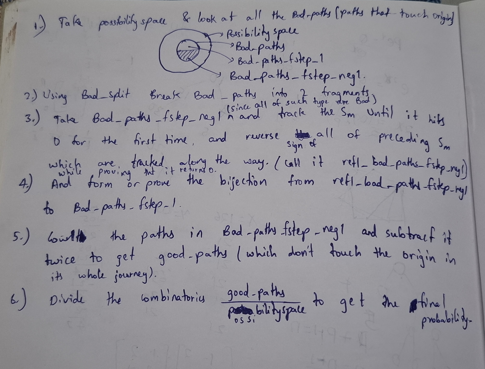

# formalizingprobability-lean

## Ballot theorem proof strategy

The proof strategy is mine (*Rediscovered*): split bad paths by their first step, pair the two
groups by reflecting each path up to its first return to 0, and count the
remaining good paths to obtain the probability.

## Scope

This repository contains a complete Lean 4 formalization of *Bertrand's Ballot Theorem*.

* *In Scope:* 
  * Combinatorial definitions of valid ballot sequences and lattice paths.
  * A direct, non-inductive proof of the Ballot Theorem using *André's reflection principle*.
* *Out of Scope:* 
  * Weak ballot variants (allowing ties during the count).
  * Measure-theoretic or probability-space formulations.
* *Dependencies & Approach:* 
  * Built on Lean 4 and mathlib (used only for basic data structures, arithmetic, and tactics; no probability theory libraries are used).
* *Verification Status:* 
  * *Complete.* The project compiles cleanly with zero sorry placeholders and uses only standard Lean axioms.

## Proof Overview (André's Reflection Principle)

*Instead of using mathematical induction, this formalization proves Bertrand's Ballot Theorem via an explicit combinatorial bijection on lattice paths:*

1. **Partition the Possibility Space:** Consider the full `possibilityspace` of vote sequences and isolate `Bad_paths` (paths that touch or return to the origin `0` after the start).
2. **Split by First Step (`Bad_split`):** Partition `Bad_paths` into two disjoint subsets based on their first step:
   * `Bad_paths_fstep_1`: Bad paths starting with `+1`.
   * `Bad_paths_fstep_neg1`: Bad paths starting with `-1` (note that every path starting with `-1` is automatically bad when `p > q`).
3. **Reflect Prefix Until First Zero:** For each path in `Bad_paths_fstep_neg1`, track the partial sum `S_m` until it hits `0` for the first time, and reverse the sign of all steps preceding that first zero (producing `refl_bad_paths_fstep_neg1`).
4. **Construct the Bijection:** Prove a bijection between `refl_bad_paths_fstep_neg1` and `Bad_paths_fstep_1`.
5. **Count Good Paths:** Since both subsets of `Bad_paths` have equal cardinality, count `Bad_paths_fstep_neg1` and subtract twice that count from the total `possibiliyspace` to obtain `good_paths` (paths that never touch the origin after step `0`).
6. **Compute the Final Probability:** Divide the number of `good_paths` by the size of the `possibilityspace`:

**Probability** = `|good_paths| / |possibility_space| = (p - q) / (p + q)`

This is the original six-step plan I wrote on paper before formalizing the
proof in Lean. It shows the idea behind the argument.

## Build Instructions

1. Ensure [Lean 4](https://lean-lang.org) (`elan`) is installed.
2. Fetch precompiled `mathlib` binaries: `lake exe cache get`
3. Compile the formalization: `lake build`

**The Bulky Sections of Lean syntax was written with AI assistance.**
